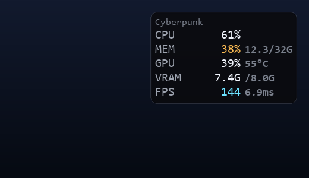
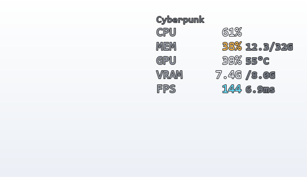

# PerfOSD — 桌面性能悬浮窗

一个绿色的 Windows 小工具：像微星小飞机（MSI Afterburner）+ RTSS 那样，在桌面和别的应用
上面浮一块半透明面板，实时显示 **CPU 占用 / 内存占用 / GPU 占用 / 帧率（FPS）**。

- 纯 Python + ctypes，**只有 `pillow` 一个第三方依赖**
- 逐像素透明、圆角、**始终置顶**；窗口**完全不接收鼠标**（点击直接穿透到下层），不抢焦点
- 任务栏留一个按钮，右键「关闭窗口」即可退出；位置靠热键/配置切换，不需要拖动
- **背景蒙版可以一键关掉**，切成纯文字贴着桌面，几乎不挡画面
- 留白、行距、标题行字号都按字号自适应收紧，同样字号下比早期版本省掉约 40% 面积
- 采集端不往游戏里注入 DLL（帧率走 Intel PresentMon 的 ETW 事件）

两种模式，`Ctrl+Alt+B` 一键切：

| 有蒙版（默认） | 纯文字（无背景） |
| --- | --- |
|  |  |

> 纯文字模式的字带黑色描边，压在白窗口、白网页上也看得清；周边一点像素都不占，
> 适合全屏看片、盯代码、逛网页时嫌那块黑底碍事的情况。

面板尺寸都由内容算出来：6 行（含游戏名标题）在 125% 缩放下约 247×155，纯文字约 239×147；
没有帧率数据时标题行不出现，面板还会再矮一行。字号不变，间距只留字周围那一圈。

```
┌───────────────────────┐
│ Cyberpunk             │
│ CPU      61%          │
│ MEM      38%  12.3/32G│
│ GPU      39%  55°C    │
│ VRAM    7.4G  /8.0G   │
│ FPS      144  6.9ms   │
└───────────────────────┘
```

---

## 一、快速开始

```bat
pip install pillow        :: 只缺这一个包
```

然后双击桌面上带图标的那两个快捷方式之一（`创建快捷方式.bat` 已经把桌面版建好了）：

| 场景 | 双击哪个 |
| --- | --- |
| 只要 CPU / 内存 / GPU 数字 | **PerfOSD 性能悬浮窗** |
| 需要 FPS（推荐，会弹 UAC） | **PerfOSD 性能悬浮窗（管理员）** |

两个 `.lnk` 也在项目目录里一份。**把文件夹搬走之后**图标会失效，双击 `创建快捷方式.bat`
重新生成即可（它会自动认出当前 `pythonw.exe` 的位置和新的图标路径）。

不想用快捷方式的话，`启动.bat` / `管理员启动.bat` 是同两个入口的命令行版本。

开机自启：`Win+R` → `shell:startup` → 把 **PerfOSD 性能悬浮窗** 的快捷方式丢进去。

> 关掉（三个入口任选）：**任务栏上那个带图标按钮 → 右键 → 关闭窗口**；
> 托盘图标右键 → 退出；`Ctrl+Alt+Q`。

**这个面板不接受任何鼠标操作**——它盖住的地方，鼠标该点哪儿还是点哪儿（`WS_EX_TRANSPARENT`
常驻，从头到尾没有"解锁拖动"这种东西）。所以位置不用拖，见下面热键和配置。

---

## 二、为什么 FPS 要管理员

帧率是从 ETW（Windows 内核事件跟踪）里读的，`PresentMon` 抓 `DXGI/D3D Present` 事件需要
**管理员权限**或者加入 `Performance Log Users` 组。三种办法任选：

1. **管理员启动**（最简单）：双击 `管理员启动.bat`，或者在托盘菜单点
   「以管理员身份重启（启用 FPS）」。
2. **一次性授权，以后免提权**（管理员 CMD 里跑一次，然后注销重登）：
   ```bat
   net localgroup "Performance Log Users" %USERNAME% /add
   ```
3. 不折腾：面板上 FPS 那行会显示 `--  需管理员`，其他三项照常工作。

---

## 三、热键

| 热键 | 作用 |
| --- | --- |
| `Ctrl+Alt+M` | 显示 / 隐藏 |
| `Ctrl+Alt+B` | 背景蒙版 开 / 关（关掉就是纯文字） |
| `Ctrl+Alt+P` | 换位置：右上 → 右下 → 左下 → 左上 循环 |
| `Ctrl+Alt+Q` | 退出 |

面板本身鼠标点不动、也拖不动，这是故意的：`WS_EX_TRANSPARENT` 常驻，鼠标事件整块穿到下面去，
所以它盖住的东西交互状态一点不变。换位置只有两条路——`Ctrl+Alt+P` 循环四角，
或者直接改 `config.json` 的 `anchor` / `pos` / `margin_x` / `margin_y`。

热键被别的软件占了会自动往后找备选（`Ctrl+Alt+Shift+*` → `Ctrl+Alt+F9~F12`），
日志里会写实际用了哪个。托盘菜单里显示的才是当前真正生效的组合。

> Windows 11 默认把新的托盘图标收进任务栏的「^」溢出区。想让它一直在任务栏上：
> 设置 → 个性化 → 任务栏 → 其他系统托盘图标 → 把 **PerfOSD** 打开。

---

## 四、配置 `config.json`

改完保存，重启工具生效。`Ctrl+Alt+P` 换角会立刻写回配置，下次启动还是那个位置。

| 键 | 默认 | 说明 |
| --- | --- | --- |
| `font_size` | `16` | 基准字号，高 DPI（125%/150%）会自动放大 |
| `opacity` | `0.86` | 背景不透明度 0.3~1 |
| `radius` | `10` | 圆角 |
| `anchor` | `"top-right"` | 首次出现的位置：`top-right` / `top-left` / `bottom-right` / `bottom-left` |
| `margin_x` / `margin_y` | `16` | 边距 |
| `pos` | `null` | 精确到像素的绝对坐标 `[x, y]`，会盖过 `anchor`；删掉/置 null 就回到边角 |
| `background` | `true` | **蒙版开关**：`false` = 纯文字无背景（热键/托盘切完会写回这里） |
| `refresh_ms` | `100` | 重绘节流（数值变化不频繁，100ms 够用且几乎不占 CPU） |
| `sample_ms` | `500` | 采样间隔 |
| `show_app` | `true` | 面板顶部显示当前统计的是哪个程序 |
| `show_frametime` | `true` | FPS 后面跟帧生成时间（ms） |
| `show_temp` | `true` | GPU 温度 |
| `show_vram` | `true` | 显存占用（NVIDIA 有；AMD/Intel 走 PDH 时没有） |
| `gpu.backend` | `"auto"` | `auto` / `nvml` / `pdh` |
| `gpu.index` | `0` | 多显卡时用第几张 |
| `fps.enabled` | `true` | 关掉就不启动 PresentMon |
| `fps.window_s` | `1.0` | FPS 统计窗口，越小越灵敏、越大越稳 |
| `fps.pin_process` | `""` | 填 `cs2.exe` 这类 exe 名就固定统计它，不填则跟随前台窗口 |
| `fps.presentmon` | `"tools/PresentMon.exe"` | PresentMon 路径 |
| `hotkeys.*` | 见上 | 热键 |

---

## 五、原理（每个数字从哪来）

| 指标 | 数据源 | 备注 |
| --- | --- | --- |
| CPU | `GetSystemTimes` 差分 | 和任务管理器「性能」页同一个口径（含 idle 扣除） |
| 内存 | `GlobalMemoryStatusEx` | `dwMemoryLoad` 百分比 + 已用/总量 |
| GPU | `nvml.dll`（NVIDIA）→ 失败退 `PDH \GPU Engine(*)\Utilization Percentage` | PDH 那套 A/N/I 三家都注册，Win10 1709+ 可用；按 3D 引擎聚合 |
| GPU 温度 / 显存 | NVML | 只有 NVIDIA 有 |
| FPS | `PresentMon`（ETW）把 CSV 打到 stdout，本工具解析 `MsBetweenPresents` | FPS = 窗口内帧数 ÷ 这些帧的总时长，比看墙钟更抗批量输出 |

悬浮窗本身：`CreateWindowEx(WS_EX_LAYERED|TOPMOST|TOOLWINDOW|NOACTIVATE|TRANSPARENT)`，
每帧用 Pillow 画一张 RGBA 图 → 预乘 alpha → `UpdateLayeredWindow(AC_SRC_ALPHA)`。
所以是真透明（不是抠色），不会闪，也不会把桌面变成纯色块。

---

## 六、已知限制（说实话）

1. **独占全屏（Exclusive Fullscreen）的游戏看不到面板**。这是 Windows 的合成器行为：
   普通窗口没法画到独占全屏的 swapchain 上，除非往进程里注入 hook——那正是 RTSS 干的事，
   代价是反作弊风险。**游戏里切「无边框窗口 / 全屏窗口化」就正常显示**（现在 99% 的游戏都这么跑）。
2. FPS 没有管理员权限就没有。
3. AMD / Intel 显卡只有占用率，没有显存和温度（要读需要厂商 SDK）。
4. 多显示器：默认贴在**主显示器**；跨屏要改 `config.json` 的 `pos`，不会自动适配不同 DPI 的缩放。
   另外因为它要在任务栏留按钮，Alt-Tab 里也会列出一个 PerfOSD（点它不会激活，纯占位）。
5. 首次运行会在缩略图/托盘生成 `assets/icon.ico`。

---

## 七、目录

```
perf-osd/
├─ main.py                  入口：采样线程 + 消息循环 + 托盘/任务栏
├─ perf_osd/
│  ├─ win32.py              ctypes 封装：分层窗口 / DIB / 热键 / 托盘 / 进程枚举
│  ├─ overlay.py            画面板 + UpdateLayeredWindow
│  ├─ metrics.py            CPU / 内存
│  ├─ gpu.py                NVML + PDH 两条 GPU 后端
│  ├─ fps.py                PresentMon 子进程 + FPS 统计
│  └─ config.py             JSON 配置
│  └─ icon.py               图标绘制（启动器 / 托盘 / 快捷方式共用一个 .ico）
├─ assets/icon.ico          多尺寸图标 16→256
├─ PerfOSD 性能悬浮窗.lnk     带图标的启动快捷方式
├─ PerfOSD 性能悬浮窗（管理员）.lnk
├─ 创建快捷方式.bat           搬家后重建快捷方式
├─ tools/PresentMon.exe     Intel 官方 PresentMon 2.6.0（x64）
├─ tools/make_shortcuts.ps1  快捷方式生成的 PowerShell 脚本
├─ 启动.bat                 普通权限启动
├─ 管理员启动.bat            提权启动（解锁 FPS）
├─ config.json              运行时生成
└─ perf-osd.log             日志
```

自检：

```bat
python main.py --probe      :: 连采 6 次打印四个指标，不开窗
python main.py --console    :: 带控制台日志运行
```

---

## 八、许可证

代码 MIT，见 [LICENSE](LICENSE)。`tools/PresentMon.exe` 是 Intel 官方 PresentMon 2.6.0，
同为 MIT，版权归 Intel，说明见 [THIRD_PARTY_NOTICES.md](THIRD_PARTY_NOTICES.md)。

不联网、不写注册表、不装服务、没有遥测；唯一的外部进程是随主程序一起退出的 PresentMon。

---

## 九、卸载

托盘退出 → 删掉整个 `perf-osd` 文件夹即可。不写注册表、不装服务、不留后台进程
（PresentMon 是本工具的子进程，随主程序退出一起结束）。
